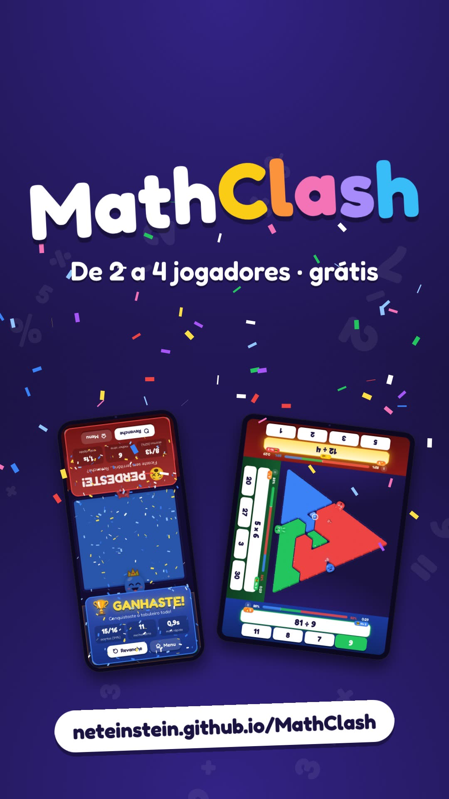

# MathClash ⚔️➕✖️


[](assets/launch.mp4)

*Vídeo de lançamento (22 s), feito com [/brag](https://github.com/latent-spaces/brag) a partir de jogos reais: telemóvel a 2, tablet a 3 (tabuleiro em triângulo) e a 4.*

Jogo de matemática **para 2 jogadores no mesmo ecrã (até 4 num tablet)** — ideal para passar o tempo enquanto esperam (no restaurante, no consultório, no carro…).

Pousem o telemóvel na mesa entre os dois: cada jogador fica numa ponta, com o seu avatar e a sua cor. Vão aparecendo contas cada vez mais difíceis, com 4 hipóteses de resposta. **Acertar faz a tua cor expandir pelo tabuleiro** (e roubar casas ao adversário!); **errar faz a tua cor encolher** um bocadinho. Ganha quem conquistar o tabuleiro todo — ou quem tiver mais território quando o tempo acabar.

Num **tablet** podem jogar **3 ou 4**: cada um senta-se num lado do ecrã e tudo o que é seu (contas, respostas, avatar) fica virado para si. Com 3, o tabuleiro é um **triângulo** 🔺.

Corre na **web** (também instalável como app e funciona offline) e em **Android** (APK nativo via Capacitor).

## Como se joga

1. No menu, cada jogador escolhe o **avatar** (toca nele para mudar), a **cor** e o **nível** — dá para jogar miúdos contra graúdos. O nível decide que contas aparecem:

   | Nível | Contas |
   |---|---|
   | 🐣 Pequeno | só somar e subtrair |
   | 🙂 Fácil | somar, subtrair e multiplicar |
   | 😎 Médio | as 4 operações |
   | 🔥 Difícil | tudo: contas mistas, número em falta, quadrados, raízes, percentagens, negativos… |
   | 🧠 Génio | tudo, a começar já com números grandes |

2. Escolham a duração (1, 2, 3 min ou sem limite) e carreguem todos em **PRONTO!**
3. Depois do 3, 2, 1… respondam o mais depressa possível. Cada jogador tem as suas próprias contas, viradas para si.

| | |
|---|---|
| ✅ Resposta certa | A tua cor expande (casas neutras primeiro, depois as do adversário) |
| ❌ Resposta errada | Perdes algumas casas e ficas bloqueado ~1 segundo (a resposta certa é mostrada) |
| 🔥 Série de acertos | 3, 5 e 8 seguidas dão cada vez mais casas |
| ⚡ Resposta rápida | Menos de 2,5 s dá bónus |
| ⭐ Conta dourada | Vale o dobro |
| 😈 Diabinho | 10 acertos seguidos enviam um diabinho que atravessa o tabuleiro: o adversário (com 3-4 jogadores, o que tem mais território) recebe uma conta bem mais difícil (mesmas operações do nível dele, números maiores). Se a acertar, vale a dobrar |
| 📈 Dificuldade | A cada 4 acertos os números ficam maiores (as operações não mudam); com o passar do tempo cada acerto vale mais |
| 🏠 Casa do avatar | Só pode ser roubada quando é a última — é o golpe final! |

Com teclado (versão web em computador): Jogador 1 usa `1 2 3 4` ou `A S D F`, Jogador 2 usa `7 8 9 0` ou `H J K L`, Jogador 3 usa `Q W E R` e Jogador 4 usa `Y U I O`. `Esc` ou `P` pausa.

### Até 4 jogadores (tablets)

Em ecrãs grandes (o lado mais curto com pelo menos 600 px — tablets, não telemóveis) aparece no menu o botão **👥 2/3/4 jogadores**. Com 3 ou 4:

- Cada jogador fica num lado: **1 em baixo, 2 em cima, 3 à esquerda, 4 à direita** — o menu, as contas, o avatar e os cartões de pausa e de resultado ficam virados para cada um.
- **Com 3 jogadores o tabuleiro é um triângulo** feito de triângulos pequenos, com um lado virado para cada jogador. Com o tablet em pé aponta para a direita ▶; deitado, o jogador 2 passa para a direita e o triângulo aponta para cima ▲, para aproveitar o ecrã. Com 4 o tabuleiro é quadriculado.
- O tabuleiro tem um avatar em cada lado e podes roubar casas a qualquer adversário.
- Quem fica sem território **sai do jogo** (😵 FORA!) e os outros continuam; ganha o último que resta, ou quem tiver mais território quando o tempo acabar.
- O 😈 diabinho vai sempre para o adversário com mais território.
- No fim, cada um vê o seu lugar (🥇 🥈 🥉).

Num telemóvel joga-se sempre a 2.

## Desenvolvimento

Requisitos: Node.js 22+.

```bash
npm install
npm run dev        # servidor local (abre também no telemóvel pela rede local)
npm test           # testes (gerador de contas, tabuleiro, regras)
npm run build      # versão web final em dist/
```

Truque para testar: abre `?bots=1,2` no URL e o computador joga sozinho dos dois lados (`?bots=1,2,3,4` para um jogo a 4).

### Estrutura

```
src/
  questions.ts   gerador de contas (operações por nível, números a crescer por etapa) e respostas erradas plausíveis
  board.ts       lógica do tabuleiro (quadriculado, ou triangular a 3): expandir, encolher, roubar, inundação final
  rules.ts       equilíbrio do jogo: recompensas, penalizações, subida de nível
  renderer.ts    desenho do tabuleiro em canvas, com animação de "tinta a espalhar"
  avatar.ts      avatares SVG com expressões (feliz, triste, espantado, coroa…)
  fx.ts          partículas, estrelas e confetis
  audio.ts       efeitos sonoros sintetizados (sem ficheiros de áudio)
  ui/menu.ts     ecrã inicial (configuração de cada jogador)
  ui/game.ts     ecrã de jogo, pausa e resultados
  ui/seats.ts    disposição a 3-4 jogadores: um lugar em cada lado do ecrã, rodado para quem lá está
android/         projeto nativo Android (Capacitor)
```

## Android

O projeto Android está em `android/` (Capacitor 8). A app fica sempre em modo retrato, em ecrã inteiro e sem o ecrã se desligar durante o jogo.

**Descarregar o APK já feito:** cada push gera o APK no GitHub Actions (workflow *CI* → artefacto `MathClash-apk`). Ao criar uma tag `v*` (ex.: `v1.0.0`) o APK é anexado automaticamente à *Release*.

**Compilar localmente** (requer Android SDK e Java 21):

```bash
npm run android:apk          # gera android/app/build/outputs/apk/debug/app-debug.apk
npm run android:open         # ou abrir no Android Studio
```

Para instalar o APK no telemóvel é preciso permitir a instalação de "apps de origem desconhecida".

Os ícones e o ecrã de arranque são gerados a partir de `assets/icon-mark.svg` com `npm run icons`.

## Web

`npm run build` gera um site estático em `dist/` que funciona em qualquer servidor (caminhos relativos) e offline depois da primeira visita (service worker). No Android, o Chrome permite "Adicionar ao ecrã principal" para jogar como uma app.

### iPhone / iPad

A versão web funciona no Safari do iOS (iOS 14.5 ou mais recente). Para jogar em ecrã inteiro e sem internet: abrir o site no **Safari → Partilhar → Adicionar ao ecrã principal**.

- Não há vibração (o iOS não deixa as páginas web vibrar).
- Com o iPhone em **modo silencioso** não há som — é o próprio iOS que silencia os jogos web.
- A web não consegue fixar a rotação do ecrã: se o iPhone rodar ao pousá-lo na mesa, ativem o **bloqueio de rotação** no Centro de Controlo.
- O zoom com dois dedos está bloqueado no jogo, para que dois toques ao mesmo tempo não sejam confundidos com um "beliscar".

O workflow *Publicar versão web* publica automaticamente no **GitHub Pages** a cada push para `main`. Para isso ficar ativo, é preciso ir uma vez a **Settings → Pages → Source** e escolher **GitHub Actions**.
